## 2. Implémenter et tester la classe Transaction 
Pour créer une transaction, il faut utiliser le pattern Builder
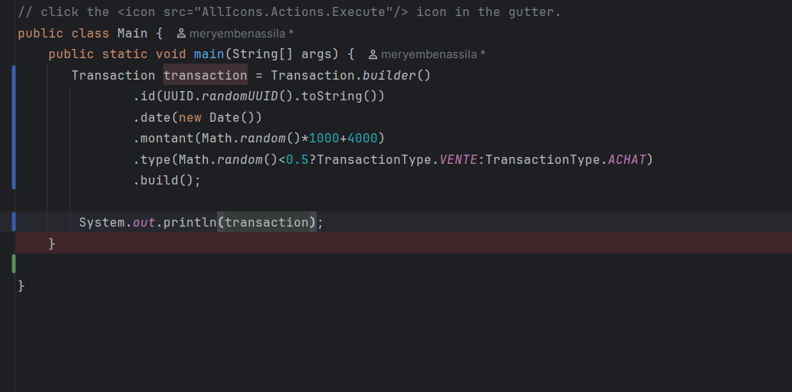

## 3. Implémenter et tester la classe Agent

Chaque agent peut s’enregistrer (souscription) chez les autres agents via une opération
  de souscription pour devenir un observateur. A chaque fois qu’on ajoute une
  transaction à un agent, il faut notifier les autres agents qui ont fait une souscription.
  La notification transmet un évènement qui contient le nom de l’agent et la transaction
  ajoutée.

  **Test**:
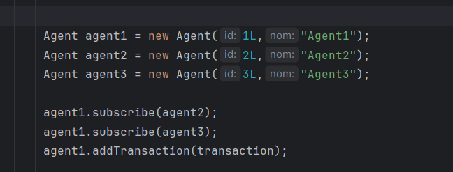
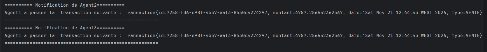

Pour se mettre à jour après une notification, l’agent doit pouvoir définir plusieurs  stratégies de traitement de la notification. Par défaut, un agent utilise une stratégie
par défaut, mais il peut changer de stratégie au moment de l’exécution. On propose de définir d’autres stratégies suivantes :

- ScoringStratégy : permet de calculer un solde en ajoutant ou en retranchant le
montant de la transaction de l’événement de notification
-  HistotyStrategy : permet garder l’historique des transactions des notifications
- D’autres stratégies peuvent être définies de manière extensible.

**Test**:

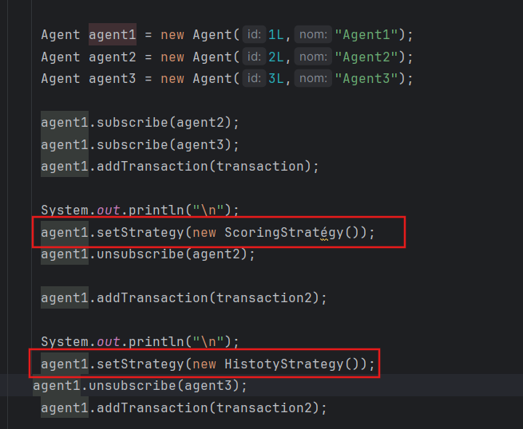

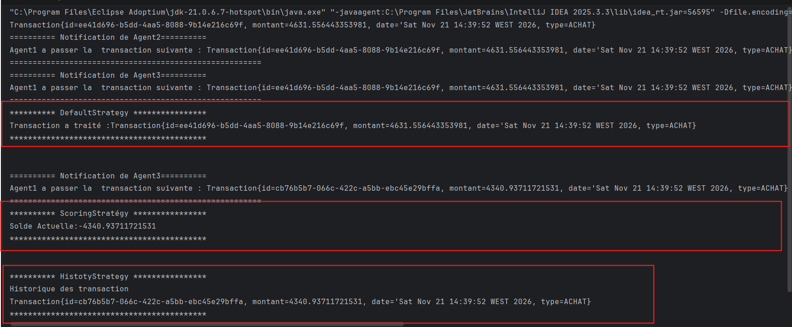

Dans l’agent, on doit définir des opérations classiques comme l’affichage du nom de
l’agent et de ses transactions et une opération qui calcule et retourne la transaction
qui a le montant le plus grand.

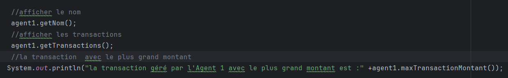

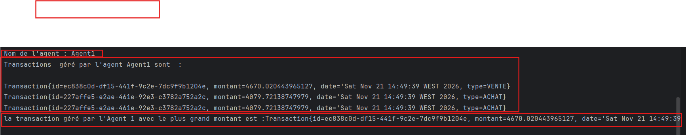

## 4. Implémenter et tester la classe Container

Le conteneur d’agents gère une collection de type HashMap d’agents. La clé
représente le nom de l’agent et la valeur représente l’agent. Le conteneur définit des
opérations classiques comme l’ajout, la suppression ou la recherche d’un agent. Le
conteneur d’agents existe en une instance unique dans l’application.

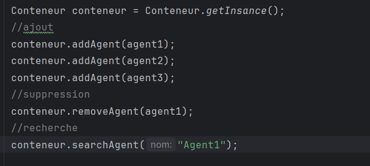

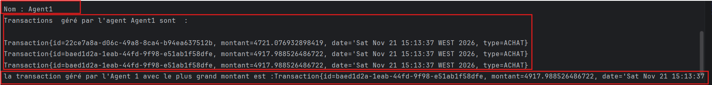

Le conteneur d’agents délègue l’affichage de son état à des afficheurs via un interface standard
HDMI. Tout afficheur implémentant l’interface standard HDMI peut être branché au
conteneur d’agent. Pour les afficheurs qui n’implémentent pas l’interface standard
HDMI, par exemple VGA, il faudrait définir une solution
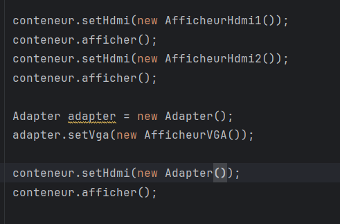
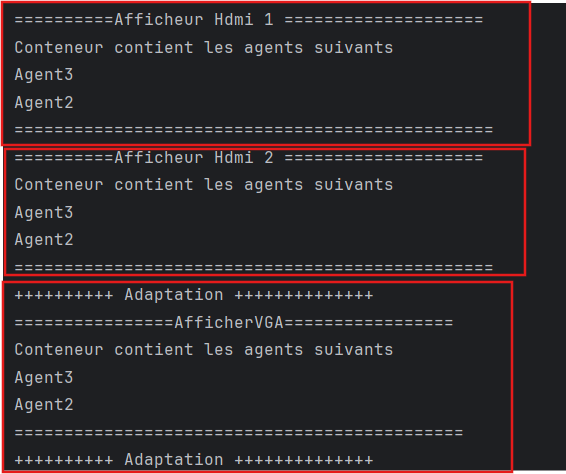

## 6. Implémenter les aspect techniques :
   a. Un aspect de journalisation basé sur une annotation @Log à créer. Cet aspect
   devrait loger la durée d’exécution de chaque méthode annotée par @Log

   b. Un aspect qui permet de définir un cache basé sur une annotation
   @Cachable. Cet aspect devrait être appliqué à la méthode de l’agent qui
   permet de retourner la transaction qui le plus grand montant.
   c. Un aspect qui permet de sécuriser l’application avec un username et un mot
   de passe et avec des roles. On définira une annotation de type
   @SecuredBy(roles={"role1","role2", etc. })